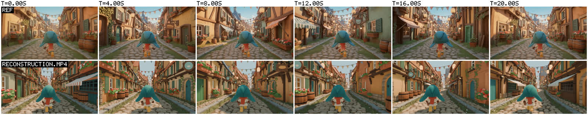
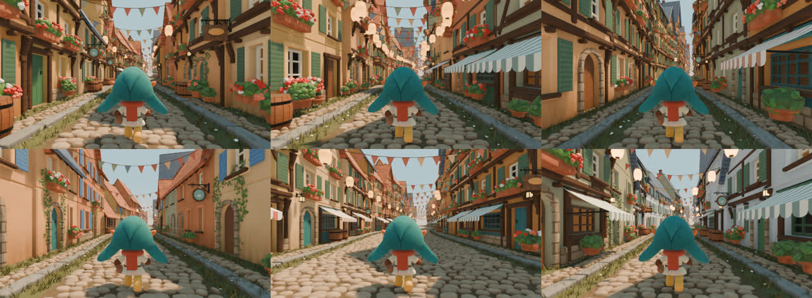
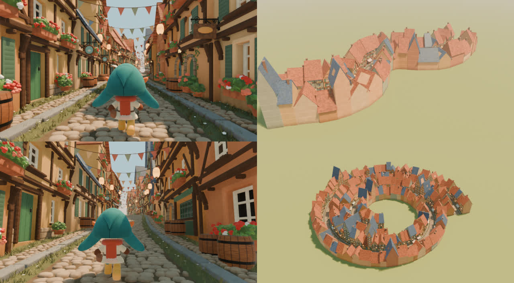

# Video to Blender

A skill that teaches coding agents to build **procedural Blender node systems** from Python: Geometry Nodes
generators, Shader Node materials, simulation zones and compositor looks. The result is a set of readable node
groups an artist can open, understand and change, and that work on new input geometry. It works with Claude Code,
Codex, Cursor, Copilot, Gemini and others.

Give it a reference (an AI-generated video, a photo, a few views, or just a description), or nothing at all. It
builds the effect as native, editable nodes, not a baked mesh or an image sequence. The skill pairs a workflow with
**nodekit**, a Python graph builder and inspector, and a **tested node-group library**: 34 `NK` groups in 6 modules,
each built, evaluated and numerically checked in Blender. Blender 5.2 or later is required.

GALLERY_PLACEHOLDER

## Why

Agents writing Blender node scripts work blind: they cannot see the graph or the render, Blender's Python API
changed in 5.x, and a script that runs can still leave a broken or unreadable graph. Common results:

- modifier inputs set as ID properties, which raises in 5.2;
- a shared node group rebuilt in place, silently unlinking every user;
- sockets looked up by index, which breaks when a node's mode changes;
- a single 300-node group with no frames or descriptions;
- motion baked as keyframes where a function of time would do;
- a "procedural" asset that only works on the one input it was built for.

This skill closes those gaps:

- **nodekit builds graphs from Python** the way you would write them by hand. Sockets are found by name, panels
  and ranges are declared, blocks are framed with a sentence, and the layout is automatic. It reads the result
  back as JSON, lints it, and sets modifier inputs the 5.2 way.
- **Tested building blocks** you instance instead of re-deriving. Each is checked in Blender with numbers, for
  example:
  - the curve frame is orthonormal on hills;
  - a bend preserves centreline length;
  - parcel widths sum to the curve length;
  - scatter counts follow density;
  - a planted foot never slides;
  - spring gain matches the analytic formula;
  - premultiplied haze has no halos.
- **A checker and a validator.** `nodes_tools.py check` builds and evaluates every group with zero warnings and
  zero lint. `validate.py` reopens a saved .blend and checks warnings, evaluation time and camera clearance.
- **A workflow with a definition of done:** artist controls (a Primary panel of macros), presets, sweeps, reuse on
  other inputs, temporal checks for animation, and honest reporting.
- **Reference-driven reconstruction** as one optional prompt
  ([`prompts/reference-to-nodes-prompt.md`](prompts/reference-to-nodes-prompt.md)), not a requirement.

## Install

**Claude Code** (plugin marketplace):

```bash
claude plugin marketplace add gokayfem/video-to-blender
```

```bash
claude plugin install video-to-blender@video-to-blender
```

Or copy the skill: `cp -R skills/procedural-blender-nodes ~/.claude/skills/`.

**Codex, Cursor, Gemini CLI, Copilot and other agents** (via [skills](https://github.com/vercel-labs/skills)):

```bash
npx skills add gokayfem/video-to-blender
```

Or install by hand:

- **Codex:** copy `skills/procedural-blender-nodes` to `~/.agents/skills/`.
- **Cursor:** copy it to `~/.cursor/skills/`, plus the rule in `adapters/cursor/`.
- **Copilot:** `gh skill install gokayfem/video-to-blender procedural-blender-nodes`, plus `adapters/copilot/`.
- **Gemini CLI:** `gemini extensions install https://github.com/gokayfem/video-to-blender`.

**claude.ai:** zip `skills/procedural-blender-nodes` and upload it under Settings > Capabilities > Skills.

**ChatGPT, Gemini Gems and other chat tools:** see [`adapters/`](adapters/).

You also need Blender 5.2 or later, as `blender` on PATH, `$BLENDER`, or the macOS app.

## Use

Ask naturally, for example:

- *"Make a Geometry Nodes fence that follows any curve, with controls for post spacing and lean."*
- *"Ivy that grows over whatever mesh I give it."*
- *"Recreate this clip as an editable Blender setup."*
- *"Port my 4.2 node script to Blender 5.2."*

The agent routes the request, finds groups, writes a build script that saves a .blend, and checks it:

```bash
python3 scripts/nodes_tools.py search curve fence
python3 scripts/nodes_tools.py try -- --module my_effect --root . --png out/try.png
blender -b my_effect.blend --python scripts/validate.py
```

What the commands do:

- `search` ranks library groups by name, summary, tags and uses.
- `try` builds one group on a test input, prints its node warnings and lint, and renders a still.
- `validate` reopens the saved file and checks warnings, counts, evaluation time and camera clearance.

## What's in the library

| Module | Groups |
|---|---|
| `curve` | `NK Curve Frame` (s, d, h to a level frame on any curve), `NK Curve Bend` (bend curve-space geometry onto a path), `NK Curve Samples`, `NK Curve Parcels` (random widths that sum exactly, with fan data for bends), `NK Curve Ribbon` |
| `shapes` | `NK Rounded Box`, `NK Chamfer Box` / `NK Chamfer Boxes` (chamfer size independent of scale), `NK Rod`, `NK Ring`, `NK Profile Revolve` (pots, barrels, vases), `NK Leaf`, `NK Blossom`, `NK Foliage Mound` |
| `scatter` | `NK Scatter On Surface` (density, Poisson distance, slope/attribute masks, alignment), `NK Scatter Along Curve`, `NK Clumps` |
| `motion` | `NK Damped Spring`, `NK Gait Step` (integrated phase, planted feet), `NK Wind Gust`, `NK Pendulum Sway`, `NK Time Remap` (loop, ping-pong, ease), `NK Flicker` |
| `materials` | shader groups: `NK Attribute Tint`, `NK Stucco`, `NK Wood Grain`, `NK Stone`, `NK Felt`, `NK Terracotta`, `NK Stripes`, `NK Glow Glass`, plus `make_material()` |
| `post` | compositor groups: `NK Haze Over Sky` (mist haze on premultiplied geometry over a sky gradient), `NK Soft Glow` |

The full catalog with inputs and uses is
[`references/library-index.md`](skills/procedural-blender-nodes/references/library-index.md).

## Worked project: Storybook Street



[`prompts/storybook-street/`](prompts/storybook-street/) rebuilds a 20 s AI-generated village clip as a
curve-driven street generator. One modifier makes the cobbled road, half-timbered houses, props, bunting in the
wind and a walking character with planted feet. A camera rig follows the walker on any path. It has a Primary
panel of eight macro controls, six presets, and the same graph on an S-bend, a hill and a spiral town.

It was measured against the reference over time (colour, luma percentiles, image motion) and validated by
reopening the file. Its README reports the results and the remaining differences honestly, and its
[workflow](prompts/storybook-street/docs/WORKFLOW.md) became the reusable
[reference-to-nodes prompt](prompts/reference-to-nodes-prompt.md).

| Variations of one graph | The same graph on other curves |
|---|---|
|  |  |

## Verification

| Check | Where | What it proves |
|---|---|---|
| Static rules | `nodes_tools.py check` | every library group is registered with a summary and uses, has an `NK` name, and follows module order; the index is current |
| Build + lint + evaluate | `nodes_tools.py check` (in Blender) | every group builds, every group and input has a description, no dangling nodes or invalid links, zero node warnings on test inputs |
| Property tests | `nodes_tools.py test` (`tests/test_*.py`) | TESTS_PLACEHOLDER |
| Templates | `tests/build_gallery.py` | every template builds, reopens with zero warnings and lint, and renders its gallery image |
| Skill effect | `evals/` (`claude plugin eval`, paid, manual) | output-rule adherence with the skill vs without it on 6 Blender tasks, and no false triggers on 3 near-miss tasks; see [evals/README.md](evals/README.md) |

CI (`.github/workflows/checks.yml`) downloads Blender 5.2.2 for Linux, checks its SHA-256, and runs the checks
headless.

## Repository

```text
skills/procedural-blender-nodes/   the skill: SKILL.md, nodekit/, library/, templates/, references/, scripts/
tests/                             property tests, Blender test runner, gallery builder, eval validator
evals/                             plugin eval suite: with vs without the skill
gallery/                           rendered templates
prompts/                           reference-to-nodes prompt and the Storybook Street project
adapters/                          prompts for tools without skill support
.claude-plugin/                    Claude Code plugin + marketplace manifests
```

Contributing: see [AGENTS.md](AGENTS.md) for the rules every library change must pass. The sibling project for
GLSL is [shader-skills](https://github.com/gokayfem/shader-skills).

## Credits and license

MIT. All code is original. The techniques and sources are listed in [CREDITS.md](CREDITS.md).
