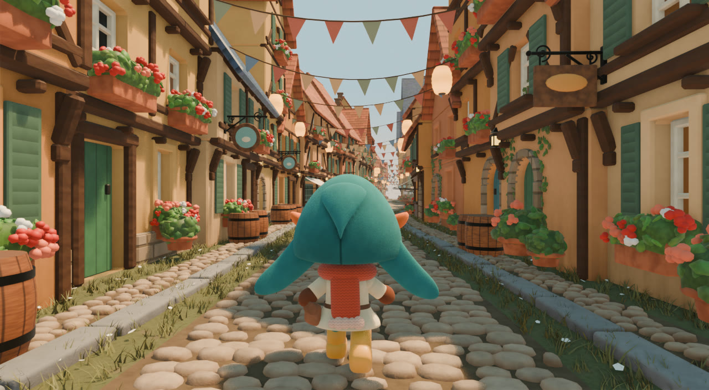
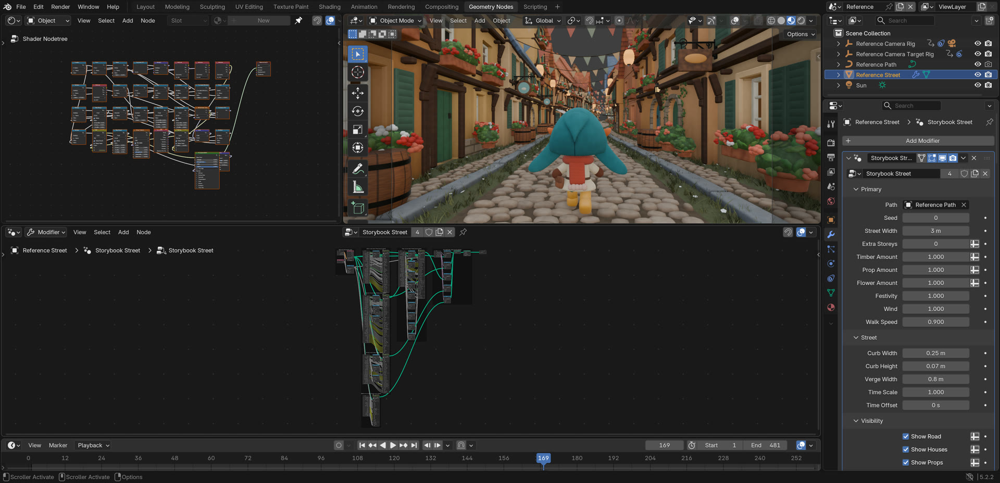
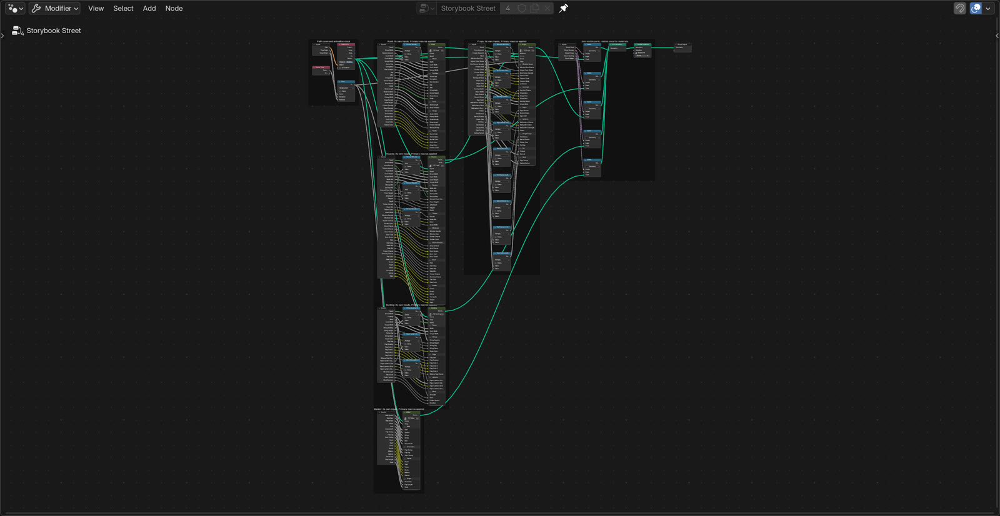
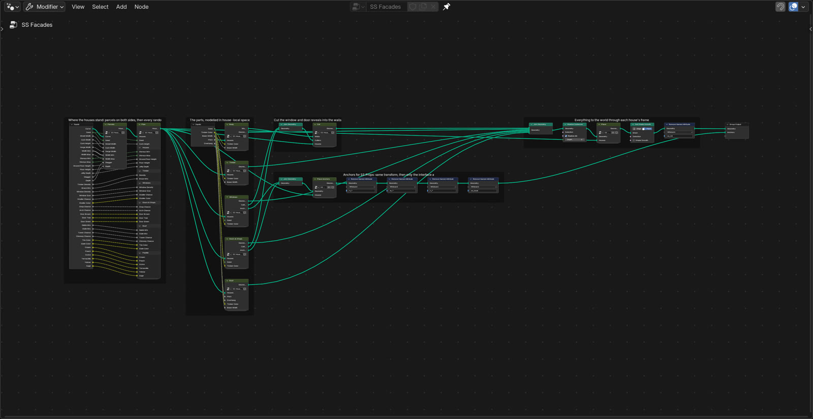
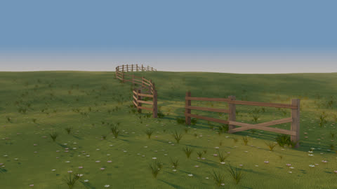
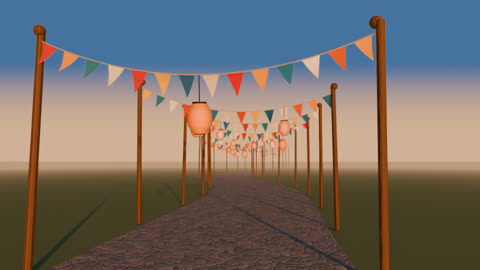
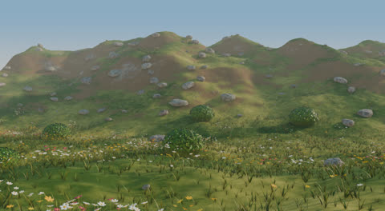
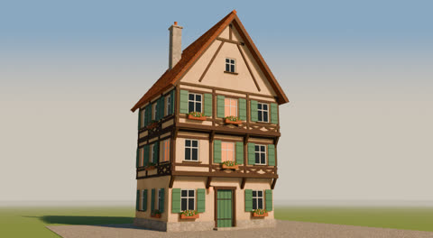
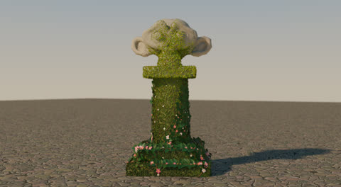

# Video to Blender

**Turn a reference video, image or idea into an editable procedural Blender node system.** A skill for coding
agents (Claude Code, Codex, Cursor, Copilot, Gemini) that builds native Geometry Nodes, Shader Nodes and compositor
graphs from Python, with a tested node-group library and validation tools.

<p align="center"></p>

<p align="center"></p>

| The top-level graph: one modifier builds the whole street | One part opened: the houses, framed block by block |
|---|---|
|  |  |

**Storybook Street** ([`prompts/storybook-street/`](prompts/storybook-street/)) rebuilds a 20 s AI-generated village
clip as one Geometry Nodes modifier on a path curve: the cobbled road, half-timbered houses, props, bunting moving
in the wind, and a walker with planted feet. A camera follows the walker on any path. Every visible part is a node
graph: geometry and motion in Geometry Nodes, materials in Shader Nodes, the sky in the world shader, haze and glow
in the compositor. Python only builds those graphs and sets up the input curve, sun, camera rig and render
settings. Draw a different curve and the same graph builds a different street.

The skill pairs a workflow with **nodekit**, a Python graph builder and inspector, and a **tested node-group
library**: 39 `NK` groups in 6 modules, each built, evaluated and numerically checked in Blender. Blender 5.2 or
later is required.

## Why

Agents writing Blender node scripts work blind: they cannot see the graph or the render, Blender's Python API
changed in 5.x, and a script that runs can still leave a broken or unreadable graph. Common results:

- modifier inputs set as ID properties, which raises in 5.2;
- a shared node group rebuilt in place, silently unlinking every user;
- sockets looked up by index, which breaks when a node's mode changes;
- a single 300-node group with no frames or descriptions;
- motion baked as keyframes where a function of time would do;
- a "procedural" asset that only works on the one input it was built for.

This skill closes those gaps:

- **nodekit builds graphs from Python** the way you would write them by hand. Sockets are found by name, panels
  and ranges are declared, blocks are framed with a sentence, and the layout is automatic. It reads the result
  back as JSON, lints it, and sets modifier inputs the 5.2 way.
- **Tested building blocks** you instance instead of re-deriving. Each is checked in Blender with numbers, for
  example:
  - the curve frame is orthonormal on hills;
  - a bend preserves centreline length;
  - parcel widths sum to the curve length;
  - scatter counts follow density;
  - a planted foot never slides;
  - spring gain matches the analytic formula;
  - premultiplied haze has no halos.
- **A checker and a validator.** `nodes_tools.py check` builds and evaluates every group with zero warnings and
  zero lint. `validate.py` reopens a saved .blend and checks warnings, evaluation time and camera clearance.
- **A workflow with a definition of done:** artist controls (a Primary panel of macros), presets, sweeps, reuse on
  other inputs, temporal checks for animation, and honest reporting.
- **Reference-driven reconstruction** as one optional prompt
  ([`prompts/reference-to-nodes-prompt.md`](prompts/reference-to-nodes-prompt.md)), not a requirement.

## Install

**Claude Code** (plugin marketplace):

```bash
claude plugin marketplace add gokayfem/video-to-blender
```

```bash
claude plugin install video-to-blender@video-to-blender
```

Or copy the skill: `cp -R skills/procedural-blender-nodes ~/.claude/skills/`.

**Codex, Cursor, Gemini CLI, Copilot and other agents** (via [skills](https://github.com/vercel-labs/skills)):

```bash
npx skills add gokayfem/video-to-blender
```

Or install by hand:

- **Codex:** copy `skills/procedural-blender-nodes` to `~/.agents/skills/`.
- **Cursor:** copy it to `~/.cursor/skills/`, plus the rule in `adapters/cursor/`.
- **Copilot:** `gh skill install gokayfem/video-to-blender procedural-blender-nodes`, plus `adapters/copilot/`.
- **Gemini CLI:** `gemini extensions install https://github.com/gokayfem/video-to-blender`.

**claude.ai:** zip `skills/procedural-blender-nodes` and upload it under Settings > Capabilities > Skills.

**ChatGPT, Gemini Gems and other chat tools:** see [`adapters/`](adapters/).

You also need Blender 5.2 or later, as `blender` on PATH, `$BLENDER`, or the macOS app.

## Use

Ask naturally, for example:

- *"Make a Geometry Nodes fence that follows any curve, with controls for post spacing and lean."*
- *"Ivy that grows over whatever mesh I give it."*
- *"Recreate this clip as an editable Blender setup."*
- *"Port my 4.2 node script to Blender 5.2."*

The agent routes the request, finds groups, writes a build script that saves a .blend, and checks it:

```bash
python3 scripts/nodes_tools.py search curve fence
python3 scripts/nodes_tools.py try -- --module my_effect --root . --png out/try.png
blender -b my_effect.blend --python scripts/validate.py
```

What the commands do:

- `search` ranks library groups by name, summary, tags and uses.
- `try` builds one group on a test input, prints its node warnings and lint, and renders a still.
- `validate` reopens the saved file and checks warnings, counts, evaluation time and camera clearance.

## What's in the library

| Module | Groups |
|---|---|
| `curve` | `NK Curve Frame` (s, d, h to a level frame on any curve), `NK Curve Bend` (bend curve-space geometry onto a path), `NK Curve Samples`, `NK Curve Parcels` (random widths that sum exactly, with fan data for bends), `NK Curve Ribbon`, `NK Catenary Point` (sagging ropes and cables) |
| `shapes` | `NK Rounded Box`, `NK Chamfer Box` / `NK Chamfer Boxes` (chamfer size independent of scale), `NK Rod`, `NK Ring`, `NK Profile Revolve` (pots, barrels, vases), `NK Leaf`, `NK Blossom`, `NK Foliage Mound`, `NK Grass Tuft`, `NK Facade Frame` (one placement frame per wall face), `NK Store Local Coords` (per-piece texture space) |
| `scatter` | `NK Scatter On Surface` (density, Poisson distance, slope/attribute masks, alignment), `NK Scatter Along Curve`, `NK Clumps` |
| `motion` | `NK Damped Spring`, `NK Gait Step` (integrated phase, planted feet), `NK Wind Gust`, `NK Pendulum Sway`, `NK Time Remap` (loop, ping-pong, ease), `NK Flicker` |
| `materials` | shader groups: `NK Attribute Tint`, `NK Stucco`, `NK Wood Grain`, `NK Stone`, `NK Felt`, `NK Terracotta`, `NK Stripes`, `NK Glow Glass`, `NK Ground`, `NK Root Tip Gradient`, plus `make_material()` |
| `post` | compositor groups: `NK Haze Over Sky` (mist haze on premultiplied geometry over a sky gradient), `NK Soft Glow` |

The full catalog with inputs and uses is
[`references/library-index.md`](skills/procedural-blender-nodes/references/library-index.md).

## Storybook Street in detail, and the templates

The top of this page is [`prompts/storybook-street/`](prompts/storybook-street/). It was measured against the
reference over time (colour, luma percentiles, image motion) and validated by reopening the file; its README
reports the results and the remaining differences. It has a Primary panel of eight macro controls, six presets,
and the same graph on an S-bend, a hill and a spiral town:

| Reference (top) vs reconstruction (bottom) | Variations of one graph | The same graph on other curves |
|---|---|---|
|  |  |  |

Its [workflow](prompts/storybook-street/docs/WORKFLOW.md) became the reusable
[reference-to-nodes prompt](prompts/reference-to-nodes-prompt.md), for any reference: a video, images, or a
written description.

Smaller starting points, each built only from the library and run on more than one input, are in
[`templates/`](skills/procedural-blender-nodes/templates/):

| [](gallery/curve_fence.png) | [](gallery/wind_bunting.png) | [](gallery/surface_scatter.png) | [](gallery/parametric_house.png) | [](gallery/growth_sim.png) |
|---|---|---|---|---|
| Fence along any curve | Bunting in the wind | Scatter by slope and height | House from a few controls | Growth over any mesh (simulation zone) |

## Verification

| Check | Where | What it proves |
|---|---|---|
| Static rules | `nodes_tools.py check` | every library group is registered with a summary and uses, has an `NK` name, and follows module order; the index is current |
| Build + lint + evaluate | `nodes_tools.py check` (in Blender) | every group builds, every group and input has a description, no dangling nodes or invalid links, zero node warnings on test inputs |
| Property tests | `nodes_tools.py test` (`tests/test_*.py`) | 59 numeric tests: curve frames orthonormal on hills, bends preserving centreline length, parcel widths summing to the curve length, sample counts on open and closed curves, scatter density and spacing, warning-free empty scatters, spring gain and phase against the formula, zero foot slide, bounded wind, exact loops, material renders, premultiplied haze, and a simulation front that is monotonic and frame-rate independent |
| Templates | `tests/build_gallery.py` | every template builds, reopens with zero warnings and lint, and renders its gallery image |
| Skill effect | `evals/` (`claude plugin eval`, paid, manual) | output-rule adherence with the skill vs without it on 6 Blender tasks, and no false triggers on 3 near-miss tasks; see [evals/README.md](evals/README.md) |

CI (`.github/workflows/checks.yml`) downloads Blender 5.2.2 for Linux, checks its SHA-256, and runs the checks
headless.

## Repository

```text
skills/procedural-blender-nodes/   the skill: SKILL.md, nodekit/, library/, templates/, references/, scripts/
tests/                             property tests, Blender test runner, gallery builder, eval validator
evals/                             plugin eval suite: with vs without the skill
gallery/                           rendered templates
prompts/                           reference-to-nodes prompt and the Storybook Street project
adapters/                          prompts for tools without skill support
.claude-plugin/                    Claude Code plugin + marketplace manifests
```

Contributing: see [AGENTS.md](AGENTS.md) for the rules every library change must pass. The sibling project for
GLSL is [shader-skills](https://github.com/gokayfem/shader-skills).

## Credits and license

MIT. All code is original. The techniques and sources are listed in [CREDITS.md](CREDITS.md).
