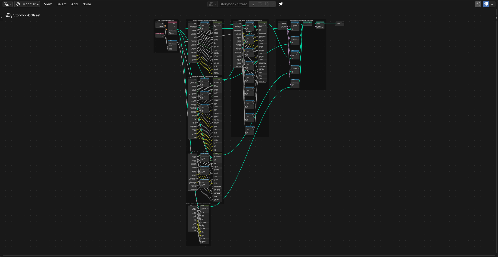
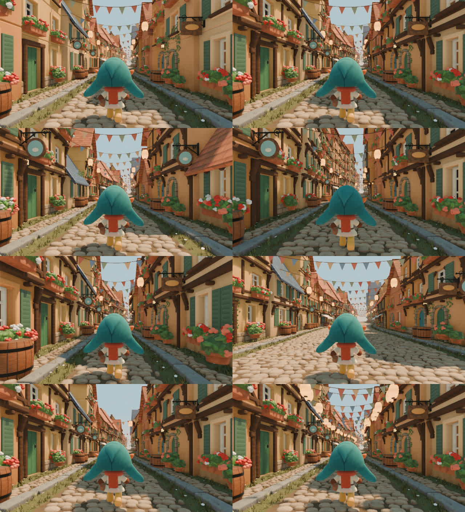

# Storybook Street (worked project)

This project lives in `prompts/storybook-street/` of the video-to-blender repository. It is the first
reference-to-nodes project, built with the `procedural-blender-nodes` skill: `scripts/...` paths below are in
`skills/procedural-blender-nodes/scripts/`, and `tools/demo.py` / `tools/light_probe.py` are this project's own.
Run commands from this folder.

## Origin: Video2Nodes

Turn an AI-generated reference video into an editable, reusable Blender node system: native Geometry Nodes,
Shader Nodes and a compositor graph, organised into readable node groups with meaningful controls.

Video2GLSL ([shader-skills](https://github.com/gokayfem/shader-skills)) showed that an imagined video can become
executable mathematics. Video2Nodes aims for an artist-usable procedural asset: open the `.blend`, read how the
effect is built from its node graphs, change the controls, and point it at new geometry.

The reference is the visual specification; the graph is an editable explanation we construct for it. It is not a
recovered "ground-truth" graph.

## First example: Storybook Street

**Reference:** a 20.04 s, 481-frame, 1280×704, 24 fps AI-generated clip of a hooded storybook character walking
down a cobbled half-timbered street under bunting
(`https://v3b.fal.media/files/b/0aaee59d/S5uoEC-Ktl6LiuqDryvhf_alligator.mp4`, sha256 `5d3066c7…bc671b7`,
downloaded to `reference/source/`, not in git).

**Result:** `street/storybook_street.blend` (under 1 MB: it stores graphs, not geometry). Its `Storybook Street`
Geometry Nodes modifier generates the whole shot from a path curve:

- a cobbled road with grass gutters, curbs, a paved strip and a grass verge;
- continuous rows of jettied half-timbered houses with real window and door reveals, shopfronts, roofs,
  chimneys and occasional slate towers;
- window boxes, awnings, hanging signs, wall lanterns, pots and barrels, placed on anchor points the houses
  publish;
- bunting and paper lanterns across the street, moved by analytic wind;
- the hooded walker, built and animated in Geometry Nodes, walking with planted feet and spring-damped flaps.

A camera rig rides the same curve, so the follow shot works on any path.

Why this example: the 20 s dolly passes many houses, so the video describes a *distribution* (house widths,
storeys, prop frequency, bunting spacing) and a motion (walk cadence, camera follow, wind) over time, not a single
picture. Swapping the input curve is the native test of whether a Geometry Nodes graph is reusable.

## The demonstration




| Six presets of the same graph | The same graph on other curves |
|---|---|
|  |  |



| Step | File |
|---|---|
| 1. The AI-generated reference | `reference/source/village_source.mp4`, sheets in `reference/sheets/` |
| 2. The reconstruction | `out/demo/reconstruction.mp4` (all 481 frames, EEVEE) |
| 3. Synchronized comparison | `out/demo/side_by_side.mp4`, `out/demo/sheet.png`, metrics in `out/demo/compare/` |
| 4. The node graph | `docs/graphs/*.png` (real node-editor screenshots), `docs/GRAPH.md` |
| 5. Control changes | `out/demo/variations.png` (six presets), `out/demo/sweep/*.mp4` (one control moving) |
| 6. Other input curves | `out/demo/transfer.png` and the `Transfer *` scenes in the .blend |

`out/` is regenerated by the commands below and is not in git; the graph screenshots in `docs/graphs/` are.

## Build and render

Blender 5.2.2 (`/opt/homebrew/bin/blender`). No add-ons, no textures, no Python packages beyond Blender's own.

```bash
blender -b --factory-startup --python street/build.py
```

```bash
blender -b street/storybook_street.blend --python ../../skills/procedural-blender-nodes/scripts/validate.py -- --hide "Show Walker"
```

```bash
python3 tools/demo.py --steps seq,compare,variations,transfer
```

```bash
python3 ../../skills/procedural-blender-nodes/scripts/graph_doc.py street/storybook_street.graph.json --top "Storybook Street" --out docs
```

- `build.py` writes the .blend and `storybook_street.graph.json`, a dump of every node group.
- `validate.py` reopens the file and checks every scene: node warnings, counts, and the follow camera's clearance.
- `demo.py` renders the sequence, comparison, variations and transfers into `out/demo/`.
- `graph_doc.py` regenerates `docs/GRAPH.md` and `docs/CONTROLS.md` from that dump.
- Use `scripts/render.py` for stills, sequences and presets, and `scripts/sweep.py` for control sweeps.
- `scripts/graph_shots.py` takes node-editor screenshots. It needs a display, so run it without `-b`.

## Using it

Open the .blend and select `Reference Street`. Its modifier panel is the control surface. **Primary** comes first:

| Control | Effect |
|---|---|
| Path, Seed | The curve to follow; every random choice |
| Street Width | Curb to curb |
| Extra Storeys | Taller or lower houses |
| Timber Amount | From plain plaster to busy framing |
| Prop Amount, Flower Amount | All prop chances; blossoms and verge flowers |
| Festivity | More bunting and paper lanterns |
| Wind | Bunting and sign motion |
| Walk Speed | The walker; the camera follows |

Every part's detailed controls follow in panels named `Road > Cobbles`, `Houses > Timber`, `Props > Awnings`
and so on (`docs/CONTROLS.md`, about 180 controls).

To use your own curve, draw any curve and pick it as **Path**, or add the modifier to a new empty mesh object.
Every part group (`SS Road`, `SS Facades`, `SS Props`, `SS Bunting`, `SS Walker`) also works on its own with a
`Curve` input.

## How it is built

See [docs/WORKFLOW.md](docs/WORKFLOW.md) for the process, [AGENTS.md](AGENTS.md) for the contracts, and
[docs/GRAPH.md](docs/GRAPH.md) for the group hierarchy.

- **Python builds native nodes.** `v2n/graph.py` adds nodes, links sockets by name, declares inputs with panels
  and ranges, frames blocks, and lays out the graph. Every group is built through it, and `v2n/inspect.py`
  reads the result back for lint and docs.
- **Street space.** `SS Street Point` maps (arc length, lateral offset, height) to world position and
  orientation on the curve. Everything is modelled in street or local space and placed through it, so the
  graph follows bends, hills and spirals.
- **Time.** Only the top group reads Scene Time. Parts take a `Time` input, so they are testable and retimable
  (`Time Scale`, `Time Offset`). All motion is analytic: gait phase is integrated from speed, planted feet are
  fixed in world space, flaps are damped-spring responses, and wind is a delayed gust curve. There is no
  simulation zone, because the reference shows nothing that needs stored state. Its bunting barely moves
  (under 1° of lantern swing) and is explained by analytic sway. See `docs/REFERENCE.md`.
- **Look.** EEVEE with ray-traced GI and AgX. The sun, sky and exposure were fitted to the reference with
  `scripts/compare.py`. The compositor graph `SS Post <scene>` adds distance haze toward the warm horizon,
  computed on premultiplied geometry, a screen-space sky gradient and a soft glow.

## Validation

Checked on the final file (`scripts/validate.py`, `scripts/compare.py`, and the commands above):

- **Rebuilds deterministically.** Two builds from nothing produce identical graph dumps: 56 node groups and
  33 materials, with zero lint problems (undocumented inputs, dangling nodes, invalid links).
- **Reopens and evaluates.** All four scenes evaluate with zero Geometry Nodes warnings. Evaluation takes
  0.20 s on the reference path (2.2M vertices), 0.11 s on the hill (1.2M), 0.20 s on the S-bend (1.6M) and
  0.48 s on the spiral (5.8M).
- **Renders.** All 481 frames render at 1280×704 with EEVEE: `out/demo/reconstruction.mp4`.
- **Follow camera.** Checked every 0.5 s on all four paths, its clearance from any geometry is at least 0.85 H,
  and it is never inside a mesh. This is checked only on these four curves, not proven for arbitrary ones.
- **No popping or flicker.** The frame-to-frame difference of the reconstruction is steady over all 480 steps
  (median 9.4, max 10.6 on a 0–255 scale, no isolated spikes). The reference ranges 8.9–12.5.
- **Feet stay planted.** Measured by the walker's test (`out/walker/shoot.py`), a boot flat on the ground moves
  0.0000 H. During heel-off the nearest vertex moves at most 0.008 H, which is the boot rolling about its toe.
  Soles sit within −0.007 to +0.002 H of the stone crowns.
- **Matched against the reference over time** (`out/demo/compare/summary.md`, every 0.5 s for 20 s; median
  absolute difference):
  - **Whole frame:** 0.012 in Oklab lightness, essentially unbiased (−0.006).
  - **Facades:** 0.016–0.037.
  - **Motion:** the street streams past at the same rate. Median image motion matches in the facades
    (about −3.5 and +4–5 px/frame) and on the road (+3.5 px/frame vertically).
  - **Walker:** its motion has the same cadence.
  - **Road:** too bright. Its sunlit highlights (90th percentile luma) are 0.21 over the reference.
  - **Sky strip:** less blue (sRGB blue −0.13).
  - SSIM is around 0.1. It is expected to be low: the generator makes a different, consistent street, not a
    pixel match of the AI clip's houses.

These are measurements of this build against this clip, not an accuracy score.

## Prior work and claims

[docs/PRIOR_WORK.md](docs/PRIOR_WORK.md) surveys the closest work:
- inverse procedural modelling;
- image-to-material-graph inference;
- agents that write Blender code, including the 2026 video-to-Blender benchmarks CineRecon and BVB;
- Geometry Nodes city and street generators.

We do not claim to be first to rebuild video in Blender, to have an agent write node graphs, or to build a
curve-driven street generator. The claim we make, with its caveats in that document: to our knowledge, a single
AI-generated clip has not previously been turned into a reusable Geometry Nodes + Shader Nodes generator whose
controls regenerate geometry, materials and time-driven animation and which runs on new input curves.

## Limitations

- **It is an interpretation, not a match.** The houses, props and their order differ from the AI clip's. The
  reference also drifts (facades reshape while in view) and morphs its last 0.3 s back to the start so it loops.
  The generator copies neither, so our 20 s does not loop.
- **Visible differences from the reference:**
  - Sunlit cobbles are too bright and the sky strip is less saturated.
  - The reference's golden side light on the left facades is stronger.
  - Our forms are boxier: chamfers are flat-shaded, plaster has little stucco relief, and stones are more uniform.
  - There are fewer large props near the camera.
  - The scarf ends in pom-poms where the reference has fringe tassels.
  - The default seed puts no slate spire at the vanishing point.
- **The camera's focal length can't be measured from the clip.** About 53° vertical is assumed (plausible range
  45–60°). Along-street lengths (walk speed, house widths) inherit that uncertainty.
- **Cost.** The modifier depends on time (walker, wind, sign swing), so Blender re-evaluates the whole tree every
  frame: 0.2–0.5 s per frame here. Playback in the viewport is not real time; for scrubbing, set Time Scale to 0
  or turn parts off. Nothing is baked, by design.
- **Curves.** Each path must be one spline, roughly horizontal (hills are fine, loops in the vertical are not).
  Bends tighter than about the street's half-width, or spiral turns closer than about 15 H, make the road and
  houses overlap themselves. On bends, cobbles compress on the inside and houses fan on the outside.
- **Extreme controls.** At Extra Storeys −1, single-storey roofs sit at eye level near the camera. Bunting
  strings always anchor at a fixed height, even above very low houses.
- **No simulation zone.** The measured motion (lantern sway under 1°, a light breeze) is explained by analytic
  motion. A simulation zone would add stored state for motion the clip does not show; a future example with
  persistent state (accumulation, growth, cloth) would need one.
- The `Transfer` scenes use an overview camera for the hero still; their follow cameras exist and are validated
  as described above.
